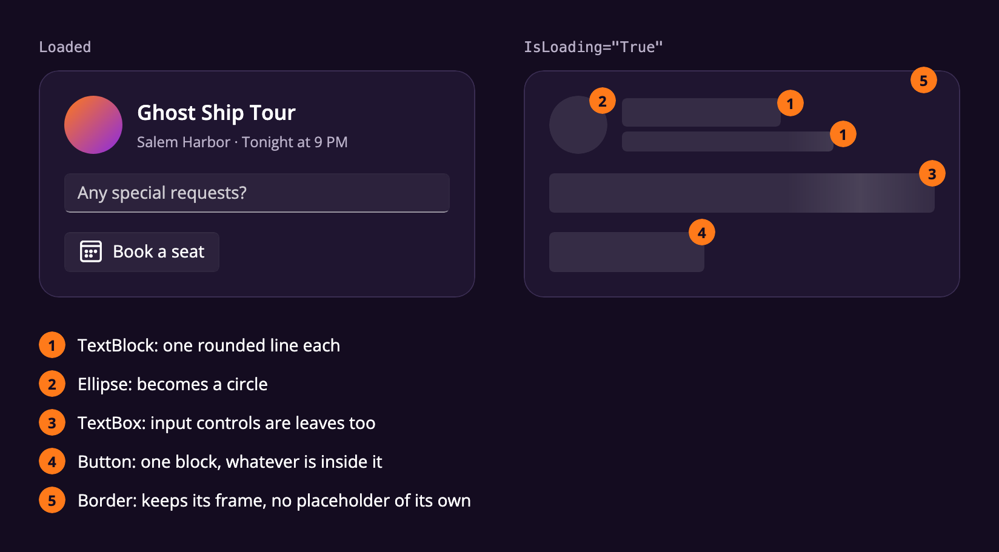
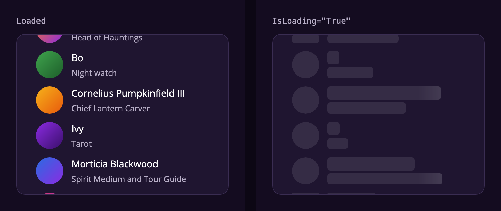
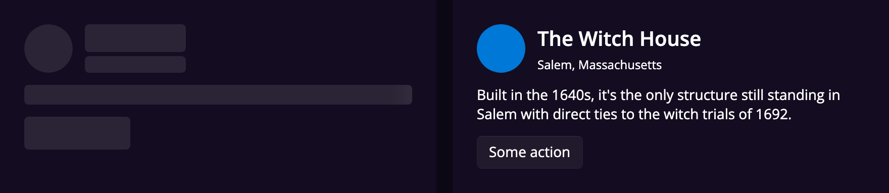
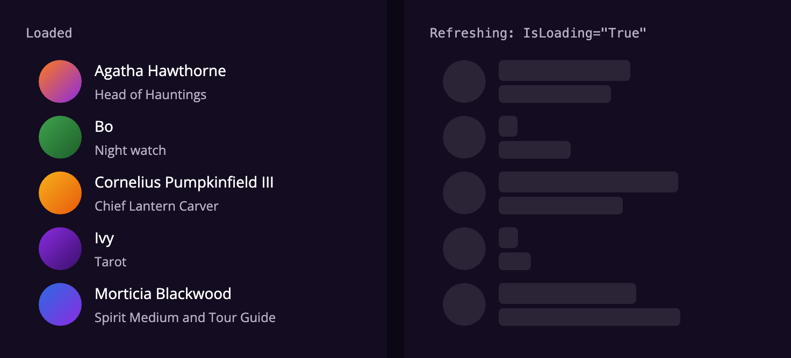
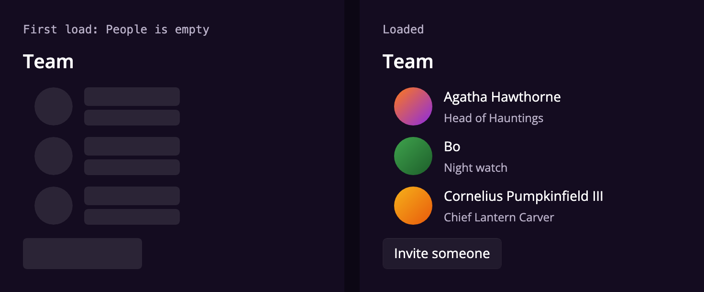
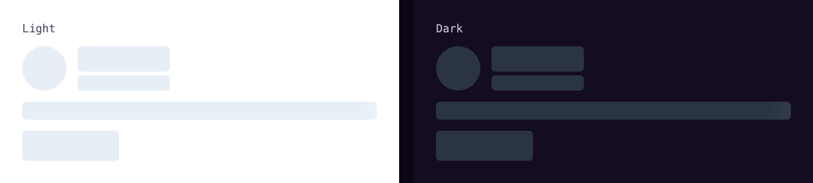

Welcome to another edition of Toolkit Tuesdays! In this series, I'll be highlighting some of the controls and helpers in the [Uno Toolkit][toolkit-homepage] library. This library is a collection of controls and helpers that we've created to make life easier when building apps with [Uno Platform][uno-homepage]. I hope you find them useful too!

This week it's `SkeletonView`, a brand-new way to show skeleton loading placeholders in your app. It shipped in [Uno Toolkit 11][toolkit-release], which landed alongside Uno Platform 7.0, so you can install it today. If you caught [my tweet][tweet] about it back when it was still a pull request, this is the longer version. It's also a natural follow-up to the [`LoadingView` post](), which mentioned a skeleton view in passing. Now we finally get to look at one.

Yes, it's November 16 and this is Halloween themed, close enough.



## The Problem (and The Solution)

Every app has a moment where the data isn't there yet. The usual answer is a spinner, and a spinner works, but it tells the user nothing about what's coming. Then the data lands and the whole layout jumps around.

The fix everyone reaches for is a skeleton: gray placeholder shapes that look like the content that's about to show up. The catch is that you normally have to build them by hand. That means a second, fake version of every screen that you have to keep in sync with the real one, and keeping that in sync is MISERABLE. Spoiler: it never stays in sync.

This is where the Uno Toolkit comes to the rescue. With `SkeletonView`, you don't declare a single skeleton shape. You wrap your real content, and while it's loading, the Toolkit generates the placeholders from the layout that's actually there.

## Anatomy of a SkeletonView

While `IsLoading` is true, `SkeletonView` walks your content and drops one placeholder on top of each leaf element at its real position. The rules are short:

1. **Leaves get one placeholder each.** A leaf is a `TextBlock`, an `Image`, any `Shape`, a button, or an input control like a `TextBox`, `ComboBox`, `Slider`, or `ToggleSwitch`. A `Button` gives you a single button-sized placeholder no matter what's inside it.
2. **Containers contribute their children, not themselves.** Panels and borders get no placeholder of their own, and neither does the chrome of a `ListViewItem` or a card.
3. **Empty values fall back to their layout slot.** A `TextBlock` bound to data that hasn't arrived measures as almost nothing, so the placeholder uses the space the layout gave it instead.
4. **An `Ellipse` becomes a circle.** Everything else becomes a rounded rectangle.

Your content stays in the visual tree the whole time, so layout and bindings keep working. Only the elements covered by a placeholder get hidden, and everything else stays visible. Placeholders are also clipped to what you can actually see, so a row scrolled halfway out of a list gets half a placeholder.





## Usage

### Basic Usage

Write your content once, as plain XAML bound to your data, and wrap it in a `SkeletonView`:

```xml
<utu:SkeletonView IsLoading="{Binding IsBusy}">
    <StackPanel Spacing="12">
        <StackPanel Orientation="Horizontal"
                    Spacing="12">
            <Ellipse Width="48"
                     Height="48"
                     Fill="{ThemeResource SystemControlHighlightAccentBrush}" />
            <StackPanel VerticalAlignment="Center"
                        Spacing="4">
                <TextBlock Text="{Binding Title}"
                           Style="{StaticResource SubtitleTextBlockStyle}" />
                <TextBlock Text="{Binding Subtitle}"
                           Style="{StaticResource CaptionTextBlockStyle}" />
            </StackPanel>
        </StackPanel>
        <TextBlock Text="{Binding Description}"
                   TextWrapping="Wrap" />
        <Button Content="Some action" />
    </StackPanel>
</utu:SkeletonView>
```

That's it. No skeleton markup anywhere.

While `IsBusy` is true, you get a circle for the avatar, two text lines, a full-width line for the description that hasn't loaded yet, and a button-shaped block. When `IsBusy` flips to false, the real content takes over.



`IsLoading` defaults to `true`, so a `SkeletonView` starts out in its loading state. If your skeleton never goes away, you forgot to bind `IsLoading` or set a `Source`.
{: .notice--warning}

### Driving It From an `ILoadable`

If you've read the `LoadingView` post, this part will look familiar. Instead of a flag, you can point `Source` at any `ILoadable`, like an async command, and the `SkeletonView` follows its `IsExecuting` state:

```xml
<Button Content="Reload"
        Command="{Binding LoadDataCommand}" />

<utu:SkeletonView Source="{Binding LoadDataCommand}">
    <TextBlock Text="{Binding Description}"
               TextWrapping="Wrap" />
</utu:SkeletonView>
```

One command drives the button AND the skeleton. Zero `IsBusy` plumbing.

The one catch is that the `ILoadable` has to raise its `IsExecutingChanged` on the UI thread. If yours finishes somewhere else, wrap it in a `LoadableSource`.



### Refreshing Content

Here's my favorite part. The placeholders come from the live layout, so turning `IsLoading` back on over content that's already loaded gives you a skeleton that matches it exactly. Same number of list items, and the text lines match the length of the current text. A spinner would blank out everything the user was just reading, but this keeps the shape of the screen right where it was.



### Empty Lists

There's one obvious gap. On a first load, a list has no items yet, so there's nothing to mirror. The fix is the `Skeleton.PlaceholderCount` attached property, which you set on the list or on any ancestor:

```xml
<utu:SkeletonView Source="{Binding LoadPeopleCommand}">
    <Grid RowSpacing="8">
        <Grid.RowDefinitions>
            <RowDefinition Height="Auto" />
            <RowDefinition Height="Auto" />
            <RowDefinition Height="Auto" />
        </Grid.RowDefinitions>
        <TextBlock Text="Team"
                   utu:Skeleton.Ignore="True" />
        <ListView Grid.Row="1"
                  utu:Skeleton.PlaceholderCount="3"
                  ItemsSource="{Binding People}"
                  ItemTemplate="{StaticResource PersonRowTemplate}" />
        <Button Grid.Row="2"
                Content="Invite someone" />
    </Grid>
</utu:SkeletonView>
```

Three rows out of a list with nothing in it. Not bad!

While loading, the empty `ListView` gets its placeholder rows built from its own `ItemTemplate`, and it reserves the space for them so the button underneath moves down as if the rows were really there. Your `ItemsSource` and the list's place in the tree are never touched, because the rows come from a hidden copy of the list.



### Tuning the Result

Did you spot `Skeleton.Ignore` on that "Team" header? Most of the time the generated skeleton is what you want. When it isn't, there are two attached properties for steering it:

```xml
<utu:SkeletonView IsLoading="{Binding IsBusy}">
    <StackPanel Spacing="12">
        <!-- static header: stays visible while loading -->
        <TextBlock utu:Skeleton.Ignore="True"
                   Text="Profile" />

        <!-- one circle instead of the image inside -->
        <Border utu:Skeleton.Shape="Circle"
                Width="64"
                Height="64"
                CornerRadius="32">
            <Image Source="{Binding AvatarUrl}"
                   Stretch="UniformToFill" />
        </Border>

        <!-- one block instead of every chip inside -->
        <ItemsControl utu:Skeleton.Shape="Rectangle"
                      Height="32"
                      ItemsSource="{Binding Tags}" />
    </StackPanel>
</utu:SkeletonView>
```

`Skeleton.Ignore` keeps an element, and everything inside it, visible and out of the generation entirely. It's perfect for headers and labels that don't depend on the data. `Skeleton.Shape` forces a placeholder shape (`Auto`, `Rectangle`, or `Circle`) and collapses the element into a single placeholder, which is handy for something like an avatar made of an `Image` inside a `Border`.


### Styling

Three lightweight styling resources control the look, and they apply to everything in this post: `SkeletonViewBackground`, `SkeletonViewShimmerBrush`, and `SkeletonViewCornerRadius`. Override them in your app resources to restyle every skeleton at once:

```xml
<ResourceDictionary.ThemeDictionaries>
    <ResourceDictionary x:Key="Light">
        <SolidColorBrush x:Key="SkeletonViewBackground"
                         Color="#E8EEF6" />
    </ResourceDictionary>
    <ResourceDictionary x:Key="Dark">
        <SolidColorBrush x:Key="SkeletonViewBackground"
                         Color="#2B3442" />
    </ResourceDictionary>
</ResourceDictionary.ThemeDictionaries>
```

Each `SkeletonView` also has per-instance properties like `SkeletonBackground`, `PlaceholderCornerRadius`, and `ShimmerDuration`. If the shimmer is too much for you, set `EnableShimmer="False"` for static placeholders, which is a nice option when you want to reduce motion.





## Beyond SkeletonView

### SkeletonPresenter

`SkeletonView` assumes your real content is in the tree while it's loading. Sometimes it isn't. A `LoadingView`'s `LoadingContent` is a good example, since that slot is shown INSTEAD of your content. For those cases there's `SkeletonPresenter`, which builds the skeleton from a `DataTemplate`:

```xml
<utu:LoadingView Source="{Binding LoadPeopleCommand}">
    <ListView ItemsSource="{Binding People}"
              ItemTemplate="{StaticResource PersonRowTemplate}" />

    <utu:LoadingView.LoadingContent>
        <utu:SkeletonPresenter utu:Skeleton.PlaceholderCount="3">
            <utu:SkeletonPresenter.ContentTemplate>
                <DataTemplate>
                    <ListView ItemTemplate="{StaticResource PersonRowTemplate}" />
                </DataTemplate>
            </utu:SkeletonPresenter.ContentTemplate>
        </utu:SkeletonPresenter>
    </utu:LoadingView.LoadingContent>
</utu:LoadingView>
```

Look at that `PersonRowTemplate`. The loaded list and the skeleton share it, so the skeleton can't drift away from the real thing.

Behind the scenes, it instantiates a private, data-less copy of the template and generates the placeholders from that, filling any empty lists with rows from their `ItemTemplate`. And since a `LoadingView` keeps its `LoadingContent` around once it's done, the presenter stops its shimmer when the `LoadingView` finishes, so nothing keeps animating out of sight. The [docs][skeleton-docs] also show how to use it inside your own control template.



### FeedView

If you're using MVUX, you're probably wondering about `FeedView`. Support for it is coming separately, as a `SkeletonFeedViewStyle` in Uno.Extensions that uses `SkeletonPresenter` for the initial load and `SkeletonView` for refreshes. It's still [in review][feedview-skeleton-pr] at the time of writing, but here's what it'll look like:

```xml
<mvux:FeedView Source="{Binding People}"
               Style="{StaticResource SkeletonFeedViewStyle}"
               utu:Skeleton.PlaceholderCount="6">
    <DataTemplate>
        <ListView ItemsSource="{Binding Data}"
                  ItemTemplate="{StaticResource PersonTemplate}" />
    </DataTemplate>
</mvux:FeedView>
```

Once it lands, one `Style` and your MVUX pages get the same skeleton :crossed_fingers:

<!-- TODO (once uno.extensions#3269 ships): recording of an MVUX FeedView with SkeletonFeedViewStyle, showing the initial load and then a refresh (feedview-skeleton.mp4). Embed it as an MP4 with the local-video include, with the width-half class for a portrait capture. Then reword this section from in review to released and repoint the link to the published FeedView docs. -->

## Rough Edges

It's shipped, but it isn't perfect. Let's still be honest about where it stands.

- The shimmer visuals aren't covered by the automated tests. The band structure is asserted, but I literally just eyeballed the sweep itself. So if you don't like it, blame Claude.
- Covered elements are hidden by setting their `Opacity` to 0 and restoring it afterwards. If you're animating or binding `Opacity` on those elements while loading, the skeleton will win.
- An empty list needs an `ItemTemplate` and a width to get rows, and `ItemTemplateSelector` isn't used for placeholder rows.
- A list's `Header` and `Footer` aren't mirrored.
- Covered controls aren't hit-testable while loading, but `Tab` can still reach them. Bind their `IsEnabled` to your loading flag if that matters for your screen.

None of these are deal-breakers, but they're worth knowing about before you build on it.

## Conclusion

`SkeletonView` is a lot of loading experience for very little XAML. Wrap your content, bind `IsLoading`, and you get a skeleton that matches the real layout, including on refresh, without maintaining a second copy of every screen.

Grab Uno Toolkit 11 and give it a spin. The Toolkit samples app has a [`SkeletonView` page][skeleton-sample] with a section for every scenario in this post, and if you hit something weird, issues and feedback are very welcome! Jump into the fun on the [Uno Toolkit GitHub repo][uno-toolkit]!

I hope you enjoyed this edition of Toolkit Tuesdays, and I'll catch you in the next one :wave:

## Further Reading

- [SkeletonView Docs][skeleton-docs]
- [SkeletonView Sample Page][skeleton-sample]
- [Uno Toolkit 11.0.1 Release][toolkit-release]
- [SkeletonView Pull Request][skeleton-pr]
- [FeedView Skeleton Loading (Uno.Extensions PR, not yet released)][feedview-skeleton-pr]
- [LoadingView Docs][loadingview-docs]
- [Uno Toolkit Docs][uno-toolkit-docs]

[tweet]: https://x.com/BiloganSteve/status/2108651624763986107
[skeleton-pr]: https://github.com/unoplatform/uno.toolkit.ui/pull/1669
[skeleton-docs]: https://platform.uno/docs/articles/external/uno.toolkit.ui/doc/controls/SkeletonView.html
[skeleton-sample]: https://github.com/unoplatform/uno.toolkit.ui/blob/main/samples/Uno.Toolkit.Samples/Content/Controls/SkeletonViewSamplePage.xaml
[toolkit-release]: https://github.com/unoplatform/uno.toolkit.ui/releases/tag/11.0.1
[feedview-skeleton-pr]: https://github.com/unoplatform/uno.extensions/pull/3269
[loadingview-docs]: https://platform.uno/docs/articles/external/uno.toolkit.ui/doc/controls/LoadingView.html

